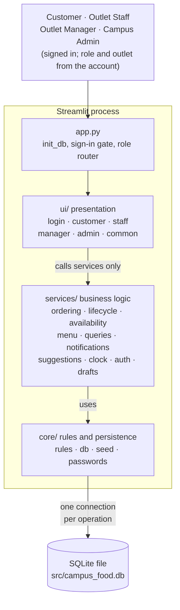
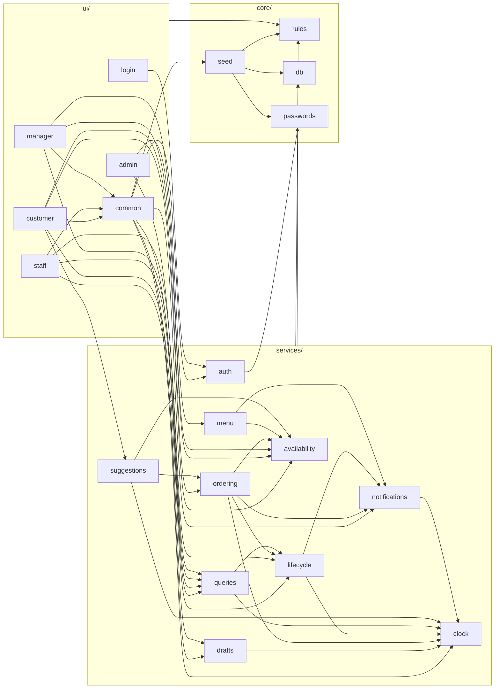
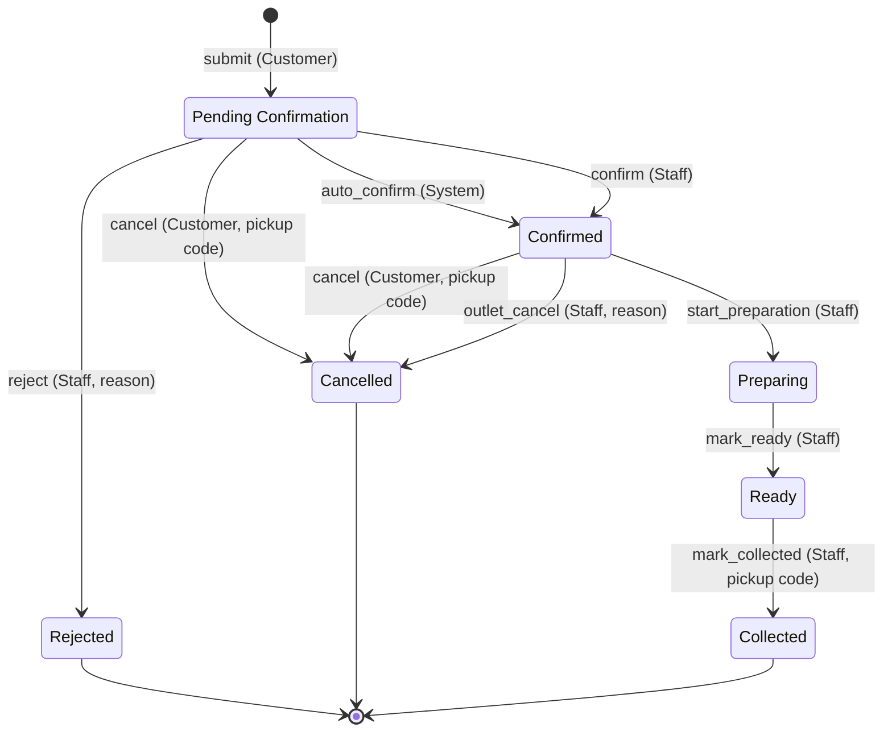
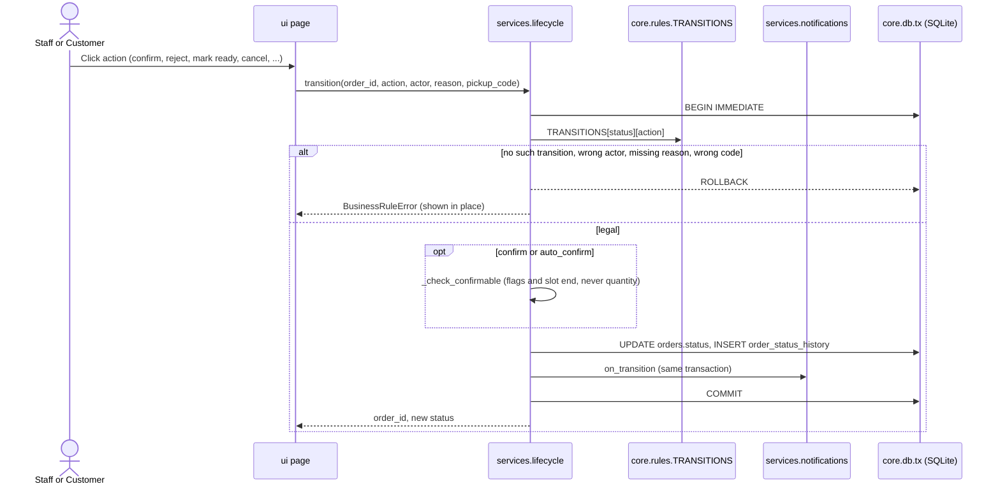
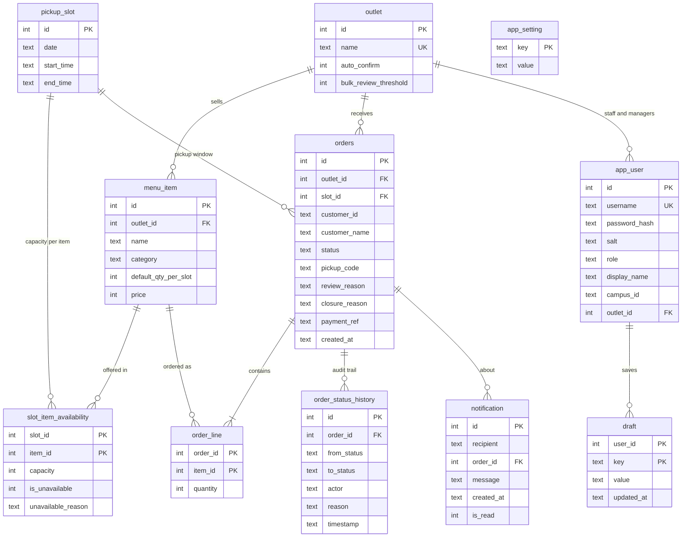

# Architecture

Campus Food Pre-Order and Pickup is a single-process Streamlit application over one SQLite
file. The code in `src/` is split into three layers with a strict one-way dependency:
`ui -> services -> core`. All business rules live in `services/` and `core/`; the UI only
renders state and forwards user actions.

See also: [System capabilities](capabilities.md) · [Class diagram](class-diagram.md) ·
[Testing](testing.md) · [Requirements v2](requirements%20and%20design/campus-food-preorder-requirements-v2.md)

## 1. Layered view



| Layer | Responsibility | Must not |
| --- | --- | --- |
| `ui/` | Streamlit pages per role, forms, buttons, toasts. Shows `BusinessRuleError` messages in place. | Contain rules or SQL. |
| `services/` | Validation, availability, state transitions, notifications, read models. One module per area. | Import Streamlit. |
| `core/` | Status constants and the transition table, SQLite connections and transactions, seed data. | Know about pages or services. |

## 2. Module dependencies

Arrows read "imports / calls". Every service module also uses `core.db` and `core.rules`;
those edges are drawn once from the group to keep the diagram readable.



## 3. Order state machine

Every status change goes through `services.lifecycle.transition`, which looks the action up in
the single `TRANSITIONS` table in `core/rules.py`. The UI derives its buttons from
`lifecycle.allowed_actions(status, actor)`, so there is no transition logic in page code.



Stock accounting follows from the status alone. `COUNTED` statuses (Pending Confirmation,
Confirmed, Preparing, Ready, Collected) use up slot capacity; entering Rejected or Cancelled
releases it. Collected keeps counting (assumption A7).

## 4. Runtime flows

### 4.1 Submit a pre-order

`submit_order` is one `BEGIN IMMEDIATE` transaction: it takes the write lock before the first
read, so two concurrent submits cannot both see the same last unit (BR-05).

```mermaid
sequenceDiagram
    actor C as Customer
    participant UI as ui.customer
    participant RA as ui.common.run_action
    participant O as services.ordering
    participant A as services.availability
    participant L as services.lifecycle
    participant N as services.notifications
    participant DB as core.db.tx (SQLite)

    C->>UI: Pay on demo checkout (outlet, slot, quantities; campus ID and name from the account)
    UI->>RA: run_action(submit_order, ...)
    RA->>O: submit_order(...)
    O->>O: check identity, normalise_lines (V-01, V-02)
    O->>DB: BEGIN IMMEDIATE
    O->>O: one outlet only, slot not started (BR-02, BR-21)
    O->>A: slot_item for every line (derived availability)
    alt any line unavailable, sold out or over-asked
        O-->>DB: ROLLBACK
        O-->>RA: BusinessRuleError listing every failing line
        RA-->>C: errors shown, nothing reserved
        UI->>UI: suggestions.next_available_slots (advice only)
    else every line fits
        O->>DB: INSERT order (Pending), order lines, history
        alt auto-confirm on and total quantity within threshold
            O->>L: apply_transition(auto_confirm, System)
            L->>N: on_transition (customer notified)
        else bulk order or manual confirmation
            O->>N: on_review_needed (outlet notified)
        end
        O->>DB: COMMIT
        O-->>RA: order_id, pickup_code, status
        RA-->>C: success message, rerun
    end
```

### 4.2 Staff or customer action on an existing order



## 5. Data model

Availability is **not** stored. It is computed on every read as
`0 if flagged else capacity - SUM(quantity over COUNTED orders)` from `slot_item_availability`
and `order_line`, so the figure cannot drift (BR-03).



`app_setting` holds the persisted app clock (`app_clock`) and the `schema_version`; it has no
relations. `draft.value` is JSON (a widget value keyed like `qty_<outlet>_<item>` or
`reason_<order>`). `orders.payment_ref` is a `DEMO-...` reference, or null for pay at counter.
`notification.order_id` is nullable (availability-flag alerts are not tied to one order), and
`recipient` is a plain string: `customer:<campus id>` or `outlet:<outlet id>`.

## 6. Key design decisions

| Decision | Where | Why |
| --- | --- | --- |
| Availability derived from orders, never a stored counter | `availability._ITEM_SQL` | A counter can drift; one formula serves seed and live data (BR-03, A5). |
| Stock reserved at submit, not at confirmation | `ordering.submit_order` | Two customers can never be accepted for the same last unit. |
| One transition table drives every action | `core/rules.py: TRANSITIONS` | Explainability (NFR-04); UI buttons come from `allowed_actions`. |
| One short-lived connection per operation, `isolation_level=None`, explicit `BEGIN IMMEDIATE` | `core/db.py: connect, tx` | Atomic check-and-reserve (BR-05, NFR-02); no shared connection across Streamlit sessions. |
| Confirm checks flags and slot end, never quantity | `lifecycle._check_confirmable` | Quantity was reserved at submit; re-checking would refuse the order that holds the last units (BR-10). |
| Notifications written inside the caller's transaction | `services/notifications.py` | A notification exists if and only if the change it describes committed. |
| App clock stored in the database | `services/clock.py`, `app_setting` | Demo date is in the past; the clock drives slot cut-offs and every timestamp (A3). |
| Pickup code returned once at submit, never by queries | `queries.list_orders` | Second factor on cancel and collect, kept after sign-in was added. |
| Slot suggestions are advice only | `services/suggestions.py` | Booking a suggested slot re-runs full `submit_order` validation (BR-22). |
| Drafts saved on every widget change | `ui.common.persist`, `services/drafts.py` | Cart and typed reasons survive sign-out, refresh and Streamlit dropping state of unrendered widgets. |
| Payment fields never leave the page | `ui.customer._checkout` | Demo only: format checks, then just a reference is stored (A10 relaxed). |
| Errors as one exception type | `core.rules.BusinessRuleError` | Services raise; `common.run_action` shows `message` and each failing `line` in place. |

## 7. Deployment and runtime

- Runs locally on Python 3.10+: `pip install -r src/requirements.txt`, then
  `streamlit run src/app.py` (NFR-01). No cloud services or external APIs.
- Dependencies: `streamlit>=1.37` (app), `pytest>=7.0` (tests). SQLite comes from the standard library.
- Data lives in `src/campus_food.db` and survives restarts. `init_db()` runs at the top of every
  app run: it creates missing tables and seeds only when no outlet exists; a database with an
  older `schema_version` is dropped and reseeded. **Reset demo data**
  drops everything and reloads the seed.
- Tests point `CAMPUS_FOOD_DB` at a temporary file, which `core.db.db_path()` reads per call.

### Known limitations

- All Streamlit sessions share one process and one SQLite file; fine for a single-machine prototype, not for many concurrent writers.
- Sign-in lives in the Streamlit session, so a browser refresh asks you to sign in again (drafts are kept).
- Demo accounts only; no sign-up or password change UI.
- Status changes appear on rerun or refresh, not by live push.
- Pending orders hold stock until staff act; overdue ones are highlighted, not auto-rejected (A14).
