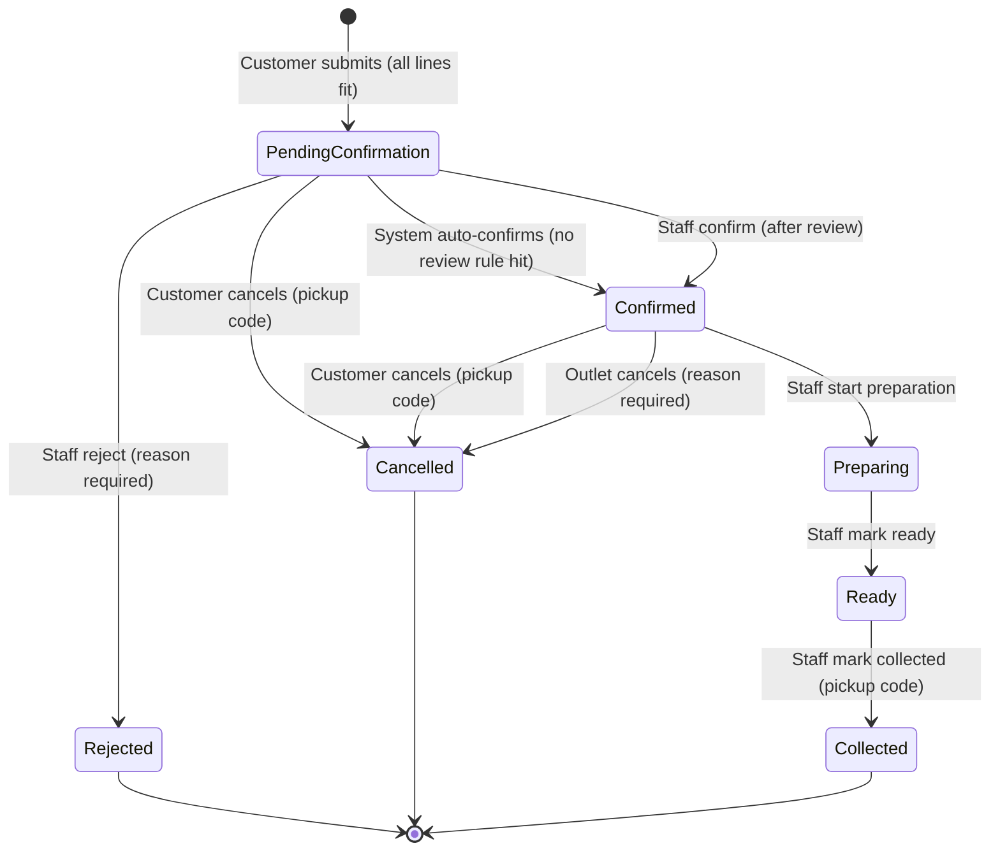

# Campus Food Pre-Order & Pickup — Requirements Specification (v2)

As of 14 Oct 2026 · Version 2 · Supersedes `campus-food-preorder-requirements.md` (v1)

## 0. What changed from v1

| # | Change | Why |
| --- | --- | --- |
| 1 | **Multi-outlet data model** (`Outlet` table, `outlet_id` on items and orders); one pre-order = one outlet | The brief says the campus has food *outlets*, each with its own menu |
| 2 | **Campus Admin** persona added; owns outlets and the pickup-slot grid | v1 left these with no owner and never said why there was no admin |
| 3 | **Hybrid confirmation**: the system auto-confirms ordinary pre-orders; bulk orders and outlets with auto-confirm off go to staff review | The brief names "delays in confirming" as a pain point; BC6 needs a confirmation *process*, not a manual one |
| 4 | Confirmation checks **flags only, never quantity** | v1 applied the availability formula at confirm, which refuses any order holding the last units |
| 5 | **Outlet-initiated cancellation** of Confirmed orders, with reason | BC8 says "an appropriate end user"; v1 could not handle an item becoming unavailable after confirmation |
| 6 | **Pickup code** required for customer cancel and staff collect; customers identified by campus ID | Without auth, anyone could cancel or collect anyone's order |
| 7 | `BEGIN IMMEDIATE` mandated for check-and-reserve | Python `sqlite3` runs a plain SELECT outside the transaction by default, so v1's BR-04 was not actually atomic |
| 8 | HOLDING renamed **COUNTED**; A7 now names its reading of BC2 | Collected keeping its units departs from BC2's literal "until … completed" and must be defended |
| 9 | "Sold out" shown automatically when available = 0 | BC5 lists sold out as an unavailability reason; it is derived, not only a manual flag |
| 10 | Status history and app clock promoted to **Must**; all timestamps use the app clock | v1 had Must requirements depending on Should ones |
| 11 | Acceptance scenarios made independent; new scenarios for auto-confirm, bulk review, outlet cancel, mixed-outlet carts, and the confirm-check trap | v1 AT-07 depended on AT-06 despite "each starts from reset" |
| 12 | **In-app notifications** become the recommended bonus | Addresses "limited visibility into order status"; first idea listed in the brief's bonus section |
| 13 | New sections: AI usage plan (13), team ownership (14), likely evaluator scenarios (15) | AI usage is 20% of the score; evaluators question each member individually |
| 14 | Build sequence revised: outlet_id from minute 0, first UI end-to-end run by ~40 min, explicit cut line | v1 had no slack and late integration |

## 1. Purpose and framing

We will build one reliable pre-order lifecycle — submit, confirm, prepare, pick up — where item quantities per pickup slot can never be oversold, and every refusal tells the customer exactly why. That is the core the brief scores; everything else is secondary.

The real problem is not "ordering food online". It is **managing a scarce, slot-bound inventory under contention, across several outlets**, with a clear state machine on top. Four things make or break the solution:

- **Availability is derived, not stored.** Available = slot capacity − quantities counted by active or completed orders. One formula, one source of truth.
- **Submit is all-or-nothing and atomic.** Either every line is reserved, or nothing is. This is the only place quantity is checked.
- **Confirmation is a process, not a click.** The system confirms ordinary pre-orders by rule and routes exceptions to staff.
- **State transitions are guarded.** Each action is legal only from specific states for specific actors, and stock is released only on Rejected or Cancelled.

Vocabulary follows the brief: a **pre-order** is a submitted request in Pending Confirmation; it becomes a **confirmed order** once the confirmation process accepts it.

Scope is sized for a 90-minute team build: multi-outlet model with two seeded outlets, one Streamlit UI with role views, SQLite, no authentication.

## 2. Stakeholders and personas

| Persona | Who | Needs from the system | Key actions | Prototype view |
| --- | --- | --- | --- | --- |
| Customer | Student or staff member ordering during a short break | Know what is available in a slot, order without queuing, see order status, cancel if plans change | Browse availability, submit pre-order, view status, cancel (before preparation) | Customer |
| Outlet Staff | Counter and kitchen team of one outlet | A clear queue, a way to review exceptions, move orders through preparation, safe handover | Review/confirm/reject pre-orders, cancel on the outlet's behalf, start preparation, mark ready, mark collected | Staff (outlet-scoped) |
| Outlet Manager | Person who owns one outlet's menu for the day | Control what can be sold per slot, react to shortages, set the confirmation policy | Flag items unavailable, set auto-confirm and bulk threshold, view slot demand, adjust capacity | Manager (outlet-scoped) |
| Campus Admin | University food-services administration | Campus-wide view of outlets, slots and demand | Owns the outlet list and the pickup-slot grid; views cross-outlet demand | Admin tab (Could); outlets and slots are seed-defined |

Why the admin has only a light view: in a 90-minute build, outlet and slot setup is done by seed data (A11), so the admin's write actions have no UI. The persona is kept because ownership of outlets and slots must sit with someone, and a cross-outlet demand view is useful to the university.

Secondary stakeholders, not given a view: event and placement coordinators (bulk demand around events; served by the bulk-review rule, BR-09).

## 3. Domain model

Availability is computed from orders, never kept as a separate counter that can drift.

| Entity | Key fields | Notes |
| --- | --- | --- |
| Outlet | id, name, auto_confirm, bulk_review_threshold | Confirmation policy per outlet; defaults auto_confirm = on, threshold = 10 |
| MenuItem | id, outlet_id, name, category, default_qty_per_slot | Each item belongs to exactly one outlet |
| PickupSlot | id, date, start_time, end_time | Campus-wide 30-minute grid shared by all outlets (A11) |
| SlotItemAvailability | slot_id, item_id, capacity, is_unavailable, unavailable_reason | One row per slot × item, created by the seed loader; capacity defaults from the menu item |
| Order | id, outlet_id, slot_id, customer_id, customer_name, status, pickup_code, review_reason, closure_reason, created_at | `closure_reason` holds the rejection or cancellation reason |
| OrderLine | order_id, item_id, quantity | One line per distinct item |
| OrderStatusHistory | order_id, from_status, to_status, actor, reason, timestamp | Actor ∈ {Customer, Staff, System}; drives the customer timeline |
| AppSetting | key, value | Persists the app clock (A3) |
| Notification *(bonus)* | id, recipient, order_id, message, created_at, is_read | Written by `transition()`; see section 12 |

The availability rule, used for **menu display and submit only**:

```
available(item, slot) = 0                                      if item is flagged unavailable for slot
                      = capacity(item, slot) − Σ qty(item)     over orders in that slot whose status ∈ COUNTED
```

COUNTED = {Pending Confirmation, Confirmed, Preparing, Ready, Collected}.

Collected orders stay COUNTED on purpose (A7): the food was handed over, so those units are consumed, not returned to the slot.

Confirmation does **not** re-run this formula. The order's own quantities are already in the sum, so an order holding the last units would show available = 0 and be wrongly refused. Confirmation checks only flags and timing (BR-10).

## 4. Order lifecycle

Seven statuses; five are COUNTED, and only Rejected and Cancelled release stock. Collected, Rejected and Cancelled are terminal.



| From | Action | Actor | To | Stock effect |
| --- | --- | --- | --- | --- |
| — | Submit | Customer | Pending Confirmation | Reserves all lines (only if every line fits) |
| Pending Confirmation | Auto-confirm | System | Confirmed | Keeps counting; runs in the same transaction as submit when no review rule applies |
| Pending Confirmation | Confirm | Staff | Confirmed | Keeps counting |
| Pending Confirmation | Reject | Staff | Rejected | Releases all lines |
| Pending Confirmation | Cancel | Customer | Cancelled | Releases all lines |
| Confirmed | Start preparation | Staff | Preparing | Keeps counting |
| Confirmed | Cancel | Customer | Cancelled | Releases all lines |
| Confirmed | Cancel by outlet | Staff | Cancelled | Releases all lines; reason shown to customer |
| Preparing | Mark ready | Staff | Ready | Keeps counting |
| Ready | Mark collected | Staff | Collected | Consumed (never returned) |

An auto-confirmed order still passes through Pending Confirmation: the history shows `— → Pending Confirmation (Customer)` then `Pending Confirmation → Confirmed (System)`, so the confirmation step is visible in the timeline.

Any action not in this table, or by the wrong actor, is refused with a message naming the current status.

## 5. Business rules

Each rule traces to a business condition (BC) in the brief, or to an assumption (A) in section 9.

| ID | Rule | Source |
| --- | --- | --- |
| BR-01 | A pre-order has exactly one customer (campus ID and name), one outlet, one pickup slot, and one or more lines; each line has one item and a whole-number quantity ≥ 1. | BC1 |
| BR-02 | Every line of a pre-order must belong to the same outlet. | BC1, A1 |
| BR-03 | Availability per item per slot follows the formula in section 3. | BC2 |
| BR-04 | Submit is all-or-nothing: if any line exceeds availability or its item is unavailable, nothing is reserved and every failing line is reported. | BC3, BC4, BC12 |
| BR-05 | Check-and-reserve runs inside one `BEGIN IMMEDIATE … COMMIT` transaction, so two concurrent submits cannot both take the last units. | BC3 |
| BR-06 | A successful submit creates the order in Pending Confirmation, issues an order number and a 4-digit pickup code, and reserves its quantities immediately. | BC2, BC6 |
| BR-07 | Every pre-order goes through the confirmation process before it becomes a confirmed order. | BC6 |
| BR-08 | If the outlet has auto-confirm on and the order's total quantity is ≤ the outlet's bulk threshold, the system confirms it in the same transaction as submit. | BC6, A9 |
| BR-09 | Otherwise the order stays in Pending Confirmation with a review reason ("Bulk order" or "Manual confirmation"), and only staff may confirm or reject it. Rejection requires a reason. | BC6, BC7, A12 |
| BR-10 | Confirmation (system or staff) checks that no item is flagged unavailable for the slot and the slot has not ended. It never re-checks quantity, because quantity was reserved at submit. | BC5, BC6 |
| BR-11 | Rejected is terminal and releases all quantities. A rejected order cannot be edited or resubmitted; the customer creates a new pre-order. | BC7 |
| BR-12 | The customer may cancel while the order is Pending Confirmation or Confirmed, using the pickup code. Cancelled is terminal and releases all quantities. | BC8, A6 |
| BR-13 | Outlet staff may cancel a Confirmed order with a reason (e.g. item became unavailable). It releases all quantities and the customer sees the reason. | BC8, A13 |
| BR-14 | From Preparing onward the customer cannot cancel; the attempt is refused with a clear message. | BC9 |
| BR-15 | A confirmed order moves forward only: Confirmed → Preparing → Ready → Collected. No step can be skipped or reversed. | BC10 |
| BR-16 | Mark collected requires status Ready and the correct pickup code. Collected is terminal; a second collect is refused. | BC11 |
| BR-17 | The manager can flag an item unavailable for one slot or all slots on a date, with a reason: Sold out, Cannot be prepared, Ingredient shortage, Operational restriction. | BC5 |
| BR-18 | A flag blocks new submits. Pending orders containing the item cannot be confirmed (staff must reject). Confirmed orders containing it are marked "Affected" in the staff queue; staff either keep them (stock already allocated) or cancel by outlet. | BC5, A8 |
| BR-19 | An item with available = 0 and no flag is shown as "Sold out" automatically. | BC5 |
| BR-20 | The manager cannot reduce a slot's capacity below the quantity already counted. | BC3 |
| BR-21 | Pre-orders cannot be submitted for a slot whose start time has passed (against the app clock, A3). | A3 |
| BR-22 | No partial fulfilment, no splitting across slots or outlets, no automatic substitution. | BC12 |

## 6. Functional requirements

Must items form the demo-able core and should be done in the first 60 minutes. Should items are next; Could items only if the core is demonstrably working.

### Customer

| ID | Requirement | Priority | Rules |
| --- | --- | --- | --- |
| FR-C1 | Select an outlet, a date and a pickup slot; see every item with its live available quantity, "Sold out", or "Unavailable — reason". | Must | BR-03, BR-17, BR-19 |
| FR-C2 | Build a pre-order from one outlet's items with quantities, enter campus ID and name, and submit. | Must | BR-01, BR-02 |
| FR-C3 | On success, see the order number, pickup code and status (Confirmed, or Pending Confirmation with the review reason). On failure, see a per-line reason and that nothing was reserved. | Must | BR-04, BR-06, BR-08, BR-09 |
| FR-C4 | View my orders by campus ID: current status, rejection/cancellation reason, and the status timeline. | Must | BC10 |
| FR-C5 | Cancel an order in Pending Confirmation or Confirmed by entering its pickup code; the button is disabled with an explanation otherwise. | Must | BR-12, BR-14 |

### Outlet Staff (scoped to one outlet)

| ID | Requirement | Priority | Rules |
| --- | --- | --- | --- |
| FR-S1 | See a queue grouped by slot and filtered by status, highlighting "Needs review", "Affected by unavailability" and "Overdue" (pending after its slot ended). | Must | BR-09, BR-18 |
| FR-S2 | Confirm a pending pre-order, or reject it with a reason. | Must | BR-09, BR-10, BR-11 |
| FR-S3 | Advance an order: Start preparation → Mark ready → Mark collected (pickup code required). Only the next legal action is offered. | Must | BR-15, BR-16 |
| FR-S4 | Cancel a Confirmed order on the outlet's behalf, with a reason. | Must | BR-13, BR-18 |
| FR-S5 | Find an order by order number at the counter. | Should | BR-16 |

### Outlet Manager (scoped to one outlet)

| ID | Requirement | Priority | Rules |
| --- | --- | --- | --- |
| FR-M1 | Flag or unflag an item as unavailable for one slot or a whole date, with a reason code; see how many existing orders are affected. | Must | BR-17, BR-18 |
| FR-M2 | Turn auto-confirm on or off and set the bulk review threshold. | Should | BR-08, BR-09 |
| FR-M3 | See, per slot, each item's capacity, counted quantity and available quantity. | Should | BR-03 |
| FR-M4 | Change an item's capacity for a slot, not below the counted quantity. | Could | BR-20 |

### Campus Admin

| ID | Requirement | Priority | Rules |
| --- | --- | --- | --- |
| FR-A1 | View all outlets, the slot grid, and counted vs capacity per outlet per slot. | Could | BR-03 |

### System

| ID | Requirement | Priority | Rules |
| --- | --- | --- | --- |
| FR-X1 | Load seed outlets, menus, slots and pre-committed quantities on first start, and offer a "Reset demo data" button. | Must | section 9 |
| FR-X2 | Record every status change with app-clock time, actor and reason. | Must | BC10 |
| FR-X3 | Provide an app clock setting, defaulting to 4 Aug 2026 10:00, persisted, used for slot cut-offs and all timestamps. | Must | BR-21, A3 |

## 7. Validations and error messages

Every refusal names the item, the slot and the reason, so the customer knows what to change. Validations live in the service layer, not only the UI, so they hold however the action is triggered.

| ID | When | Check | Message shown |
| --- | --- | --- | --- |
| V-01 | Submit | Campus ID and name are not blank | "Please enter your campus ID and name." |
| V-02 | Submit | At least one line; every quantity is a whole number ≥ 1 | "Add at least one item with a whole-number quantity of 1 or more." |
| V-03 | Submit | All lines belong to the selected outlet | "Samosa is sold by Snack Kiosk. A pre-order can include items from one outlet only." |
| V-04 | Submit | Slot exists and has not started | "The 12:30–13:00 slot has already started. Choose a later slot." |
| V-05 | Submit | Item not flagged unavailable for the slot | "Cold Coffee is unavailable for 13:00–13:30 on 4 Aug 2026 (Operational restriction)." |
| V-06 | Submit | Requested ≤ available for every line | "Veg Sandwich: you asked for 13, only 12 are available for 13:00–13:30." |
| V-07 | Submit | V-05 and V-06 checked for all lines before failing | All failing lines listed together, then "Your pre-order was not placed. Nothing has been reserved." |
| V-08 | Confirm | No item flagged unavailable; slot has not ended (flags and time only, not quantity) | "Cannot confirm: Masala Dosa is now unavailable (Ingredient shortage). Reject this pre-order with a reason." |
| V-09 | Reject / cancel by outlet | Reason is not blank | "A reason is required." |
| V-10 | Customer cancel | Status is Pending Confirmation or Confirmed | "Preparation has already started, so this order can no longer be cancelled." |
| V-11 | Customer cancel / collect | Pickup code matches the order | "The pickup code does not match order #12." |
| V-12 | Any transition | Transition is legal from the current status for this actor | "Order #12 is Collected; it cannot be collected again." |
| V-13 | Capacity change *(only if FR-M4 is built)* | New capacity ≥ counted quantity | "Cannot set capacity to 6: 8 units are already counted for this slot." |

Duplicate lines for the same item in one pre-order are merged into one line before validation.

## 8. Non-functional requirements

| ID | Requirement |
| --- | --- |
| NFR-01 | **Runs locally** with Python 3.10+ and one command (`streamlit run app.py`) after `pip install -r requirements.txt`. No cloud, no external APIs. |
| NFR-02 | **Data integrity**: SQLite file. Connections open with `isolation_level=None`, and check-and-reserve plus every status change run inside an explicit `BEGIN IMMEDIATE … COMMIT`. One connection per operation; never share a cached connection across Streamlit sessions. Data survives an app restart. |
| NFR-03 | **Testability**: business logic sits in a service module with no UI imports, unit-tested with pytest against a temporary database file (not `:memory:`, so the concurrency test can open several connections). |
| NFR-04 | **Explainability**: one state-transition table in code drives every allowed action and actor; no transition logic scattered in UI handlers. |
| NFR-05 | **Usability**: each role view fits one screen; only legal actions are shown as buttons; every action gives visible success or error feedback. |
| NFR-06 | **Traceability**: README links each business rule to the function and test that enforce it. |

## 9. Seed data and assumptions

The brief's committed quantities are seeded as real Confirmed orders, so the same availability formula covers seed data and live data with no special case.

### Seed data

Outlets: **Main Canteen** (the brief's menu; auto-confirm on, threshold 10) and **Snack Kiosk** (added sample outlet to show isolation; auto-confirm on, threshold 10).

Slots (campus-wide): 12:00–12:30, 12:30–13:00, 13:00–13:30 and 13:30–14:00 on 4 Aug 2026 and 5 Aug 2026 (the second date shows Cold Coffee available again).

| Outlet | Item | Category | Capacity per slot | Seeded state | Resulting availability on 4 Aug |
| --- | --- | --- | --- | --- | --- |
| Main Canteen | Veg Sandwich | Snacks | 20 | Confirmed seed order: 8 units, 13:00–13:30 | 12 in 13:00–13:30; 20 elsewhere |
| Main Canteen | Masala Dosa | South Indian | 15 | None | 15 in every slot |
| Main Canteen | Paneer Rice Bowl | Meals | 12 | Confirmed seed order: 5 units, 12:30–13:00 | 7 in 12:30–13:00; 12 elsewhere |
| Main Canteen | Cold Coffee | Beverages | 18 | Flagged unavailable, all slots on 4 Aug, reason Operational restriction | Unavailable in every slot (18 on 5 Aug) |
| Main Canteen | Fruit Bowl | Healthy Meals | 10 | Confirmed seed order: 4 units, 13:00–13:30 | 6 in 13:00–13:30; 10 elsewhere |
| Snack Kiosk | Samosa | Snacks | 25 | None | 25 in every slot |
| Snack Kiosk | Masala Chai | Beverages | 30 | None | 30 in every slot |

### Assumptions

| ID | Assumption | Why |
| --- | --- | --- |
| A1 | Multiple outlets are modelled; the prototype seeds two. A pre-order belongs to exactly one outlet. | The brief describes several outlets. Cross-outlet orders would need partial-fulfilment semantics if one outlet rejects, which BC12 rules out. |
| A2 | Capacity per slot is the menu default unless the manager changes it. | The brief gives one quantity per item per slot. |
| A3 | An app clock, defaulting to 4 Aug 2026 10:00 and persisted, decides slot cut-offs and stamps every record. | The demo date is in the past; a real clock would block every order and give timelines dated after the slot. |
| A4 | No authentication. A role selector switches views. Customers identify themselves by campus ID; a pickup code issued at submit protects cancel and collect. | Auth is optional per the brief; the pickup code closes the worst gaps (cancelling or collecting someone else's order) at minimal cost. |
| A5 | Seed commitments are Confirmed orders from placeholder customers (e.g. "Seed – Event booking"). | One availability formula, no special case. |
| A6 | The customer may also cancel while Pending Confirmation, not only when Confirmed. | BC8 names Confirmed; withdrawing an unconfirmed request is the safer, expected behaviour. |
| A7 | Collected orders keep counting their units. We read BC2's "reserved until … completed" as: on completion the reservation turns into consumption, so the units still count against the slot's capacity. | Otherwise collected units would return to the slot and it would oversell. Deliberate reading of BC2. |
| A8 | Flagging an item unavailable does not auto-cancel existing orders; staff decide (BR-18). | Keeps humans in charge of customer-facing outcomes; stock for confirmed orders may already be set aside. |
| A9 | Confirmation is hybrid: the system confirms ordinary pre-orders by rule; staff review exceptions. Default auto-confirm on, bulk threshold 10 units per order. | The brief names confirmation delays as a pain point. A pure manual step makes staff the bottleneck; a pure automatic step makes confirmation meaningless. |
| A10 | No payment, pricing or receipts. | Not in the business conditions. |
| A11 | Pickup slots are a campus-wide 30-minute grid defined in seed data. There is no UI for creating outlets or slots; the Campus Admin owns them. | Keeps the 90 minutes on the order lifecycle. |
| A12 | No hard per-order quantity cap. Orders above the bulk threshold go to staff review instead. | Event coordinators place genuine bulk orders; review stops one person silently taking a whole slot. |
| A13 | Outlet cancellation is allowed only from Confirmed. Once preparation starts, problems are handled at the counter. | Food already being prepared has its ingredients; releasing stock then would be misleading. |
| A14 | Pre-orders still pending after their slot ends are flagged "Overdue" for staff, not auto-rejected. | No background jobs in the prototype; staff decide. |

## 10. Scope, trade-offs and limitations

### In scope (90 minutes)

- The full lifecycle for one order across Customer, Staff and Manager views, at either outlet
- Hybrid confirmation (auto-confirm plus bulk review)
- All Must requirements in section 6 and the validations in section 7 that belong to them
- Seed data with a reset button, and pytest tests for the scenarios in section 11

### Out of scope

- Login, passwords, roles enforced by identity (A4)
- UI for creating outlets or slots (A11); payments, pricing
- Editing a submitted pre-order (the brief requires a new pre-order instead)
- Partial fulfilment, slot or outlet splitting, automatic substitutions (BC12)
- Email, SMS or push notifications to real devices (in-app notifications are the bonus)
- No-show handling for orders left in Ready
- Kitchen capacity or preparation-time planning

### Key trade-offs

| Decision | Chosen | Given up |
| --- | --- | --- |
| Availability | Computed from orders on every read | A little query cost, in exchange for a figure that cannot drift |
| Reservation timing | Reserve at submit, not at confirmation | Pending orders may hold stock that is later rejected; but two customers can never be accepted for the same last unit |
| Confirmation | Hybrid: rule-based auto-confirm, staff review for exceptions | Full staff control over every order; simplicity of a single path |
| Outlets | Multi-outlet model, one outlet per order | Combined carts across stalls |
| UI framework | Streamlit, one app with a role selector | Fine-grained UI control and live push updates; all sessions share one process and one SQLite file |
| Storage | SQLite file | Scale and many concurrent writers; fine for a single-machine prototype |
| Auth | None; campus ID plus pickup code | Real access control |

### Known limitations

- Anyone can switch to the staff, manager or admin view.
- Campus ID is self-declared; "My orders" shows any ID's orders, though cancelling still needs the pickup code.
- Bulk or manually reviewed pre-orders hold stock until staff act; there is no timeout (overdue ones are only highlighted).
- Orders cannot be cancelled by the outlet once preparation has started (A13).
- Status changes appear on rerun/refresh, not by live push.

## 11. Acceptance scenarios

Each scenario starts from freshly reset seed data, uses Main Canteen on 4 Aug 2026 with auto-confirm on unless stated, and becomes one pytest test against the service layer. **AT-01, AT-03 and AT-15** are the recommended live demo.

| ID | Given | When | Then | Rules |
| --- | --- | --- | --- | --- |
| AT-01 | 13:00–13:30 shows Veg Sandwich 12, Masala Dosa 15 | Asha (S101) orders 2 Veg Sandwich + 1 Masala Dosa; staff start, mark ready, and mark collected with her pickup code | Order is auto-confirmed by System at submit; Asha sees every status in the timeline; availability ends at 10 and 14 | BR-06, BR-08, BR-15, BR-16 |
| AT-02 | Veg Sandwich has 12 left in 13:00–13:30 | A customer requests 13 | Refused with "only 12 are available"; availability still 12 | BR-04 |
| AT-03 | Fruit Bowl has 6 left in 13:00–13:30 | A customer requests 2 Masala Dosa + 7 Fruit Bowl | Whole order refused, Fruit Bowl named as the reason; Masala Dosa still 15 | BR-04, BR-22 |
| AT-04 | Cold Coffee flagged unavailable on 4 Aug | A customer requests 1 Cold Coffee on 4 Aug, then on 5 Aug | 4 Aug refused with the reason; 5 Aug accepted | BR-17 |
| AT-05 | Paneer Rice Bowl has 7 left in 12:30–13:00 and 12 in 13:00–13:30 | A customer requests 8 in each slot | 12:30 refused; 13:00 accepted | BR-03 |
| AT-06 | Fruit Bowl has 6 left in 13:00–13:30 | Order A takes 6, then order B asks for 1 | A accepted, Fruit Bowl shows "Sold out"; B refused | BR-04, BR-19 |
| AT-07 | Auto-confirm is off for Main Canteen; a pre-order for 6 Fruit Bowl in 13:00–13:30 is Pending | Staff reject it with a reason | Rejected and closed; Fruit Bowl back to 6; it cannot be confirmed afterwards | BR-09, BR-11 |
| AT-08 | An order for 3 Masala Dosa is Confirmed | The customer cancels with a wrong code, then with the right code | First refused; second succeeds, status Cancelled, Masala Dosa back to 15 | BR-12 |
| AT-09 | An order is Preparing | The customer tries to cancel | Refused with "preparation has already started" | BR-14 |
| AT-10 | An order is Collected | Staff try to collect it again | Refused; status unchanged | BR-16 |
| AT-11 | Auto-confirm is off; a pending pre-order contains Masala Dosa | Manager flags Masala Dosa as Ingredient shortage; staff try to confirm | Confirm refused; reject with reason succeeds and releases stock | BR-10, BR-18 |
| AT-12 | 1 Fruit Bowl left in a slot | Two submits for 1 unit run at the same time on separate connections | Exactly one succeeds | BR-05 |
| AT-13 | App clock set to 12:45 | A customer orders for 12:30–13:00 | Refused: slot has started | BR-21 |
| AT-14 | Auto-confirm on, threshold 10 | A customer orders 12 Masala Dosa | Stays Pending Confirmation with "Bulk order" review reason; staff confirm; status Confirmed, actor Staff | BR-08, BR-09 |
| AT-15 | A Confirmed order contains 2 Masala Dosa | Manager flags Masala Dosa as Ingredient shortage; staff cancel the order by outlet with a reason | Order shows "Affected" in the queue before the cancel; then Cancelled, customer sees the reason, Masala Dosa stock released | BR-13, BR-18 |
| AT-16 | Both outlets seeded | A customer submits Veg Sandwich (Main Canteen) + Samosa (Snack Kiosk) in one pre-order | Refused with the one-outlet message; nothing reserved | BR-02 |
| AT-17 | Auto-confirm is off; a pending pre-order takes all 6 remaining Fruit Bowl (available now 0) | Staff confirm it | Confirm succeeds — quantity is not re-checked | BR-10 |
| AT-18 | Snack Kiosk order for 5 Samosa in 13:00–13:30 is Confirmed | Read Main Canteen availability for that slot | Unchanged from seed | BR-03, A1 |

## 12. Bonus feature

Recommended: **in-app notifications.** Every successful `transition()` writes a Notification row in the same transaction:

- To the customer: "Order #12 is Ready for pickup at 13:00–13:30", "Pre-order #7 was rejected: Ingredient shortage", "Order #9 was cancelled by Main Canteen: Masala Dosa unavailable".
- To the outlet: "New pre-order #14 needs review (bulk)", "Masala Dosa flagged unavailable — 2 orders affected".

The UI shows an unread badge and inbox per campus ID and per outlet, plus `st.toast` on rerun. Optional periodic refresh with `st.fragment(run_every=…)` (recent Streamlit versions). No external service is used. It tackles the brief's "limited visibility into order status" and reuses the single transition choke point.

Alternative: **"Next available slot" suggestion.** When a submit fails, list the nearest later slots at the same outlet where the whole order fits; one click re-runs the full `submit_order` validation for that slot (never trusting the figure displayed). Respects BC12 because the customer chooses.

## 13. AI usage plan

AI usage is 20% of the score. The brief rewards how the team directs, questions and validates AI output, not how much it generates.

- **`AI_LOG.md`** in the repo: for each significant prompt, record the tool, what was asked, what was accepted, changed or rejected, and why.
- **Human-written tests first** for the rules most likely to be wrong: AT-04/05 (slot isolation), AT-12 (concurrency), AT-17 (confirm does not re-check quantity). AI-generated code must pass them before merging.
- **Documented catches** to show in the demo. Already found while reviewing v1:
  1. Applying the availability formula at confirmation refuses any order holding the last units (fixed in BR-10, tested by AT-17).
  2. Default Python `sqlite3` runs the availability SELECT outside the transaction, so check-and-reserve was not atomic (fixed in BR-05/NFR-02, tested by AT-12).
- **Review rule**: every AI-generated function is read by a second team member before merge; the PR description states how it was validated.

## 14. Team ownership

Each member must be able to explain their contribution, one business rule, one part of the solution, one assumption or trade-off, and how their work was validated. Fill in names before starting.

| Member | Owns (files) | Rules they explain | Tests they validate | Assumption/trade-off they defend |
| --- | --- | --- | --- | --- |
| Member A | `db.py`, `submit_order`, availability | BR-03, BR-04, BR-05 | AT-02 to AT-06, AT-12, AT-16, AT-18 | A7 (Collected keeps counting), reserve-at-submit trade-off |
| Member B | Transition table, `transition`, confirmation rules | BR-08 to BR-16 | AT-07 to AT-11, AT-14, AT-15, AT-17 | A9 (hybrid confirmation), A13 |
| Member C | `app.py` views, README, slides, `AI_LOG.md` | BR-17, BR-18, BR-21 | AT-01 and AT-13 by hand in the UI | A3 (app clock), A4 (no auth, pickup code) |

## 15. Likely evaluator scenarios

Prepared answers for "additional scenario" questions:

| Scenario | Expected behaviour | Covered by |
| --- | --- | --- |
| Item becomes unavailable after an order is confirmed | Order marked Affected; staff keep it or cancel by outlet with reason; stock released on cancel | BR-18, AT-15 |
| Staff press "Mark collected" on an order that is not Ready | Refused, naming the current status | BR-15, V-12 |
| Manager lowers capacity below what is counted | Refused with counted quantity (if FR-M4 built) | BR-20, V-13 |
| Same item added twice in one cart | Merged into one line before validation | Section 7 |
| Quantity 0, negative or 2.5 | Refused | V-02 |
| Customer tries to cancel a rejected pre-order | Refused: Rejected is terminal | BR-11, V-12 |
| Two customers with the same name | Distinguished by campus ID; cancel needs the pickup code | A4 |
| Cart mixes two outlets | Refused with the one-outlet message | BR-02, AT-16 |
| One person orders a whole slot's stock | Above the bulk threshold, so held for staff review; staff may reject | BR-09, AT-14 |
| Customer wants to change items after rejection | Must create a new pre-order | BR-11 |
| Pre-order still pending after its slot ended | Highlighted as Overdue; staff reject | A14, FR-S1 |

## 16. Recommended solution shape

Three files of real logic, one rule per function, one transition table. Small enough that every team member can explain all of it.

- `db.py` — SQLite schema (section 3, including `outlet_id` from the start), connection helper with `isolation_level=None`, seed loader, reset.
- `services.py` — `get_availability(outlet_id, slot_id)`, `submit_order(...)` (includes the auto-confirm decision), `transition(order_id, action, actor, reason=None, pickup_code=None)`, `set_unavailable(...)`, `set_outlet_policy(...)`. All rules and validations live here and raise one `BusinessRuleError` with the user-facing message.
- `app.py` — Streamlit: sidebar role selector, outlet selector and app clock; Customer, Staff and Manager pages that only call `services.py`.
- `tests/test_rules.py` — one test per acceptance scenario.

The transition table is a plain dictionary — `{status: {action: (next_status, allowed_actors, releases_stock, needs_reason, needs_pickup_code)}}` — so section 4 and the code say the same thing.

### Build sequence

| Time | Member A | Member B | Member C |
| --- | --- | --- | --- |
| 0–10 min | Schema with `outlet_id`, seed, reset | Transition table and `BusinessRuleError` | Repo, README skeleton, `AI_LOG.md`, pitch outline |
| 10–35 min | `submit_order` and availability, with AT-02 to AT-06, AT-16 | `transition` and auto-confirm, with AT-07 to AT-10, AT-14, AT-17 | Customer page wired to real services as soon as `submit_order` lands |
| 35–40 min | **Integration checkpoint: AT-01 end to end through the UI** | | |
| 40–60 min | Manager page (FR-M1); AT-12 concurrency | Staff page (FR-S1 to FR-S4); AT-11, AT-15 | Slides start; README assumptions and limitations |
| 60–75 min | Bonus (notifications) — only if every Must works | AT-13, AT-18; fix failures | Slides finish; demo script for AT-01, AT-03, AT-15 |
| 75–90 min | Rehearse the demo and Q&A (sections 14 and 15) | | |

**Cut line at 60 min:** if any Must is not working, drop the bonus, FR-M2 UI (set the policy in seed/tests instead), FR-M3, FR-A1 and the Snack Kiosk UI (keep its seed data and AT-16/AT-18 tests).

Each member commits through their own branch or pull request, so the repository history shows the split and the integration points.
