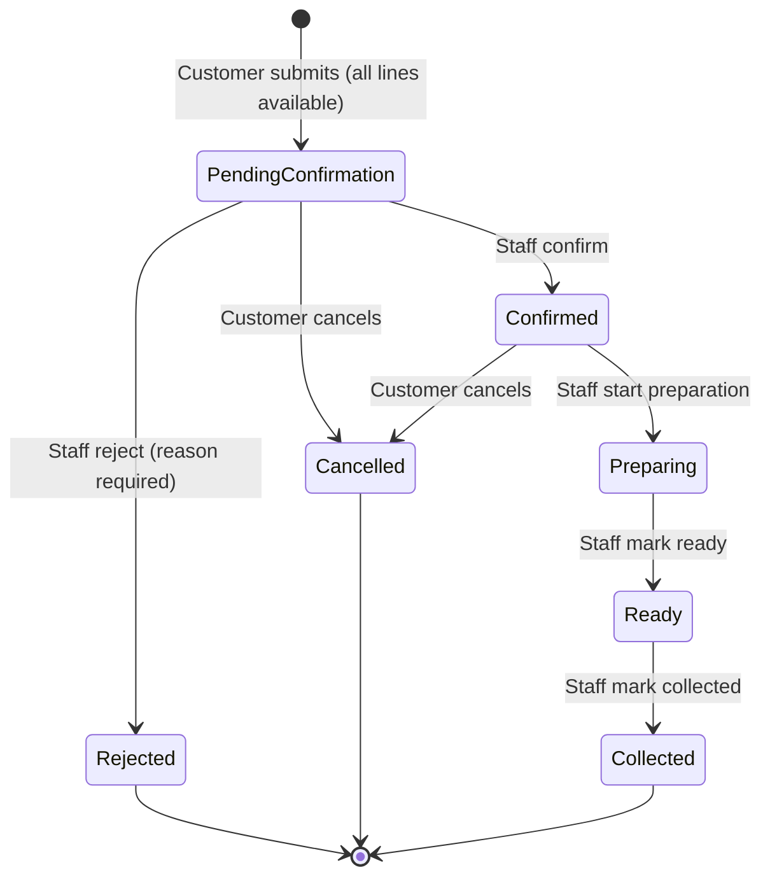

# Campus Food Pre-Order & Pickup — Requirements Specification

As of 14 Oct 2026

## 1. Purpose and framing

We will build one reliable order lifecycle — pre-order, confirm, prepare, pick up — where item quantities per pickup slot can never be oversold, and every rejection tells the customer exactly why. That is the core the brief scores; everything else is secondary.

The real problem is not "ordering food online". It is **managing a scarce, slot-bound inventory under contention**, with a clear state machine on top. Three things make or break the solution:

- **Availability is derived, not stored.** Available = slot capacity − quantities held by active orders. One formula, one source of truth.
- **Submit is all-or-nothing and atomic.** Either every line is reserved, or nothing is.
- **State transitions are guarded.** Each action is legal only from specific states, and the reservation is released only on Rejected or Cancelled.

Scope is sized for a 90-minute team build: one outlet, one UI with three role views, SQLite, no authentication.

## 2. Stakeholders and personas

Three personas carry the system; each gets its own view in the UI, chosen from a role selector.

| Persona | Who | Needs from the system | Key actions |
| --- | --- | --- | --- |
| Customer | Student or staff member ordering during a short break | Know what is available in a slot, order without queuing, see order status, cancel if plans change | Browse availability, submit pre-order, view status, cancel (before preparation) |
| Outlet Staff | Counter and kitchen team | A clear queue of pending orders, a way to move orders through preparation, safe handover at pickup | Confirm or reject pre-orders, start preparation, mark ready, mark collected |
| Outlet Manager | Person who owns the menu for the day | Control what can be sold per slot, react to shortages | Set per-slot quantities, mark items temporarily unavailable with a reason, view slot demand |

Secondary stakeholders, not given a view in the prototype: university administration (reduced queues, visibility) and event/placement coordinators (bulk demand around events).

## 3. Domain model

Six small tables are enough. Availability is computed from orders, never kept as a separate counter that can drift.

| Entity | Key fields | Notes |
| --- | --- | --- |
| MenuItem | id, name, category, default_qty_per_slot | The five items from the brief |
| PickupSlot | id, date, start_time, end_time | 30-minute windows, e.g. 12:30–13:00 |
| SlotItemAvailability | slot_id, item_id, capacity, is_unavailable, unavailable_reason | One row per item per slot; capacity defaults from the menu item |
| Order | id, customer_name, slot_id, status, reject_reason, created_at | Status follows the lifecycle in section 4 |
| OrderLine | order_id, item_id, quantity | One line per distinct item |
| OrderStatusHistory | order_id, from_status, to_status, actor, timestamp | Audit trail and status timeline for the customer |

The availability rule, applied everywhere (menu display, submit, confirm):

```
available(item, slot) = capacity(item, slot) − Σ qty(item) over orders in that slot whose status ∈ HOLDING
```

HOLDING = {Pending Confirmation, Confirmed, Preparing, Ready, Collected}. An item flagged unavailable for a slot shows 0 available, whatever the arithmetic says.

Collected orders stay in HOLDING on purpose: the food was handed over, so those units are consumed, not returned to stock.

## 4. Order lifecycle

Seven statuses; five hold stock, and only Rejected and Cancelled release it. Collected, Rejected and Cancelled are terminal.



| From | Action | Actor | To | Stock effect |
| --- | --- | --- | --- | --- |
| — | Submit | Customer | Pending Confirmation | Reserves all lines (only if every line fits) |
| Pending Confirmation | Confirm | Staff | Confirmed | Keeps holding |
| Pending Confirmation | Reject | Staff | Rejected | Releases all lines |
| Pending Confirmation | Cancel | Customer | Cancelled | Releases all lines |
| Confirmed | Start preparation | Staff | Preparing | Keeps holding |
| Confirmed | Cancel | Customer | Cancelled | Releases all lines |
| Preparing | Mark ready | Staff | Ready | Keeps holding |
| Ready | Mark collected | Staff | Collected | Consumed (never returned) |

Any action not in this table is refused with a message naming the current status.

## 5. Business rules

Each rule traces to a business condition (BC) in the brief, or to an assumption (A) in section 9.

| ID | Rule | Source |
| --- | --- | --- |
| BR-01 | A pre-order has exactly one customer, exactly one pickup slot, and one or more lines; each line has one item and a quantity ≥ 1. | BC1 |
| BR-02 | Availability per item per slot = capacity − quantities in HOLDING orders (section 3). | BC2 |
| BR-03 | Submit is all-or-nothing: if any line exceeds availability or the item is unavailable, nothing is reserved and every failing line is reported. | BC3, BC4, BC12 |
| BR-04 | Check-and-reserve happens in one database transaction, so two concurrent submits cannot both take the last units. | BC3 |
| BR-05 | A successful submit creates the order in Pending Confirmation and reserves its quantities immediately. | BC2, BC6 |
| BR-06 | Only staff can move Pending Confirmation to Confirmed or Rejected. Rejection requires a reason. | BC6, BC7 |
| BR-07 | Staff cannot confirm an order if any of its items has since been flagged unavailable for that slot; they must reject it with the reason. | BC5, BC6 |
| BR-08 | Rejected is terminal and releases all its quantities. A rejected order cannot be edited or resubmitted; the customer creates a new one. | BC7 |
| BR-09 | The customer may cancel while the order is Pending Confirmation or Confirmed. Cancelled is terminal and releases all quantities. | BC8, A6 |
| BR-10 | From Preparing onward the customer cannot cancel; the attempt is refused with a clear message. | BC9 |
| BR-11 | A confirmed order moves forward only: Confirmed → Preparing → Ready → Collected. No step can be skipped or reversed. | BC10 |
| BR-12 | Collected is terminal. A second collect attempt is refused. | BC11 |
| BR-13 | The manager can flag an item unavailable for one slot or all slots on a date, with a reason: Sold out, Cannot be prepared, Ingredient shortage, Operational restriction. | BC5 |
| BR-14 | Flagging unavailable blocks new submits only. Existing orders are kept and handled by staff (BR-07). | BC5, A8 |
| BR-15 | The manager cannot reduce a slot's capacity below quantities already held. | BC3 |
| BR-16 | Orders cannot be placed for a slot whose start time has passed (against the app clock, A3). | A3 |
| BR-17 | No partial fulfilment, no splitting across slots, no automatic substitution. | BC12 |

## 6. Functional requirements

Must items form the demo-able core and should be done in the first 60 minutes. Should items are next; Could items only if the core is demonstrably working.

### Customer

| ID | Requirement | Priority | Rules |
| --- | --- | --- | --- |
| FR-C1 | Select a date and pickup slot and see every item with its live available quantity, or "Unavailable — reason". | Must | BR-02, BR-13 |
| FR-C2 | Build a pre-order with one or more items and quantities, enter a name, and submit. | Must | BR-01 |
| FR-C3 | On success, see the order number and status Pending Confirmation. On failure, see a per-item reason and confirm nothing was reserved. | Must | BR-03, BR-05 |
| FR-C4 | View my orders with current status, rejection reason if any, and the status timeline. | Must | BC10 |
| FR-C5 | Cancel an order in Pending Confirmation or Confirmed; the button is disabled with an explanation otherwise. | Must | BR-09, BR-10 |

### Outlet Staff

| ID | Requirement | Priority | Rules |
| --- | --- | --- | --- |
| FR-S1 | See a queue of orders grouped by slot and filtered by status. | Must | — |
| FR-S2 | Confirm a pending order, or reject it with a reason. | Must | BR-06, BR-07, BR-08 |
| FR-S3 | Advance an order: Start preparation → Mark ready → Mark collected. Only the next legal action is offered. | Must | BR-11, BR-12 |
| FR-S4 | Find an order by order number at the counter to hand it over. | Should | BR-12 |

### Outlet Manager

| ID | Requirement | Priority | Rules |
| --- | --- | --- | --- |
| FR-M1 | Flag or unflag an item as unavailable for one slot or a whole date, with a reason code. | Must | BR-13, BR-14 |
| FR-M2 | See, per slot, each item's capacity, held quantity and available quantity. | Should | BR-02 |
| FR-M3 | Change an item's capacity for a slot, not below the held quantity. | Could | BR-15 |

### System

| ID | Requirement | Priority | Rules |
| --- | --- | --- | --- |
| FR-X1 | Load the seed menu, slots and pre-committed quantities on first start, and offer a "Reset demo data" button. | Must | section 9 |
| FR-X2 | Record every status change with time and actor. | Should | BC10 |
| FR-X3 | Provide an app clock setting, defaulting to 4 Aug 2026 10:00, used for slot cut-off checks. | Should | BR-16 |

## 7. Validations and error messages

Every refusal names the item, the slot and the reason, so the customer knows what to change. Validations live in the service layer, not only the UI, so they hold however the action is triggered.

| ID | When | Check | Message shown |
| --- | --- | --- | --- |
| V-01 | Submit | Customer name is not blank | "Please enter your name." |
| V-02 | Submit | At least one item with quantity ≥ 1; quantities are whole numbers | "Add at least one item with a quantity of 1 or more." |
| V-03 | Submit | Slot exists and has not started | "The 12:30–13:00 slot has already started. Choose a later slot." |
| V-04 | Submit | Item not flagged unavailable for the slot | "Cold Coffee is unavailable for 13:00–13:30 on 4 Aug 2026 (Operational restriction)." |
| V-05 | Submit | Requested ≤ available for every line | "Veg Sandwich: you asked for 13, only 12 are available for 13:00–13:30." |
| V-06 | Submit | V-04 and V-05 checked for all lines before failing | All failing lines listed together, then "Your pre-order was not placed. Nothing has been reserved." |
| V-07 | Confirm | All items still available for the slot | "Cannot confirm: Masala Dosa is now unavailable (Ingredient shortage). Reject this order with a reason." |
| V-08 | Reject | Reason is not blank | "A rejection reason is required." |
| V-09 | Cancel | Status is Pending Confirmation or Confirmed | "Preparation has already started, so this order can no longer be cancelled." |
| V-10 | Any transition | Transition is legal from the current status | "Order #12 is Collected; it cannot be collected again." |
| V-11 | Capacity change | New capacity ≥ held quantity | "Cannot set capacity to 6: 8 units are already held for this slot." |

Duplicate lines for the same item in one order are merged into one line before validation.

## 8. Non-functional requirements

Keep these few and testable; the brief rewards a reliable, explainable system over a broad one.

| ID | Requirement |
| --- | --- |
| NFR-01 | **Runs locally** with Python 3.10+ and one command (`streamlit run app.py`) after `pip install -r requirements.txt`. No cloud, no external APIs. |
| NFR-02 | **Data integrity**: SQLite with a write transaction around check-and-reserve and every status change (BR-04). Data survives an app restart. |
| NFR-03 | **Testability**: business logic sits in a service module with no UI imports, so it can be unit-tested with pytest. |
| NFR-04 | **Explainability**: one state-transition table in code drives every allowed action; no transition logic scattered in UI handlers. |
| NFR-05 | **Usability**: each role view fits one screen; only legal actions are shown as buttons; every action gives visible success or error feedback. |
| NFR-06 | **Traceability**: README links each business rule to the function and test that enforce it. |

## 9. Seed data and assumptions

The brief's committed quantities are seeded as real Confirmed orders, so the same availability formula covers seed data and live data with no special case.

### Seed data

Slots: 12:00–12:30, 12:30–13:00, 13:00–13:30 and 13:30–14:00 on 4 Aug 2026 and 5 Aug 2026 (the second date shows Cold Coffee available again).

| Item | Category | Capacity per slot | Seeded state | Resulting availability on 4 Aug |
| --- | --- | --- | --- | --- |
| Veg Sandwich | Snacks | 20 | Confirmed seed order: 8 units, 13:00–13:30 | 12 in 13:00–13:30; 20 elsewhere |
| Masala Dosa | South Indian | 15 | None | 15 in every slot |
| Paneer Rice Bowl | Meals | 12 | Confirmed seed order: 5 units, 12:30–13:00 | 7 in 12:30–13:00; 12 elsewhere |
| Cold Coffee | Beverages | 18 | Flagged unavailable, all slots on 4 Aug, reason Operational restriction | 0 in every slot (18 on 5 Aug) |
| Fruit Bowl | Healthy Meals | 10 | Confirmed seed order: 4 units, 13:00–13:30 | 6 in 13:00–13:30; 10 elsewhere |

### Assumptions

| ID | Assumption | Why |
| --- | --- | --- |
| A1 | One outlet only. The model can take an outlet_id later. | The brief's data describes one menu. |
| A2 | Capacity per slot is the menu default unless the manager changes it. | The brief gives one quantity per item per slot. |
| A3 | An app clock, defaulting to 4 Aug 2026 10:00, decides whether a slot has started. | The demo date is in the past; a real clock would block every order. |
| A4 | No authentication. A role selector switches views; the customer types a name, and "My orders" filters by it. | Optional per the brief; 90 minutes is better spent on rules. |
| A5 | Seed commitments are Confirmed orders from placeholder customers (e.g. "Seed – Event booking"). | One availability formula, no special case. |
| A6 | The customer may also cancel while Pending Confirmation, not only when Confirmed. | BC8 names Confirmed; withdrawing an unconfirmed request is the safer, expected behaviour. |
| A7 | Collected orders keep holding their units. | Food handed over is consumed, not returned to stock. |
| A8 | Flagging an item unavailable does not auto-reject existing orders; staff decide at confirmation (BR-07). | Keeps humans in charge of customer-facing outcomes. |
| A9 | Confirmation is a manual staff action. | BC6 requires a confirmation process; manual is the simplest that is explainable. |
| A10 | No payment, pricing or receipts. | Not in the business conditions. |

## 10. Scope, trade-offs and limitations

### In scope (90 minutes)

- The full lifecycle for one order across all three role views
- All Must requirements in section 6 and all validations in section 7
- Seed data with a reset button, and pytest tests for the rules in section 11

### Out of scope

- Login, passwords, roles enforced by identity (A4)
- Multiple outlets, payments, pricing
- Editing a submitted order (the brief requires a new pre-order instead)
- Partial fulfilment, slot splitting, automatic substitutions (BC12)
- Email, SMS or push notifications to real devices
- No-show handling for orders left in Ready
- Kitchen capacity or preparation-time planning

### Key trade-offs

| Decision | Chosen | Given up |
| --- | --- | --- |
| Availability | Computed from orders on every read | A little query cost, in exchange for a figure that cannot drift |
| Reservation timing | Reserve at submit, not at confirmation | Pending orders may hold stock that is later rejected; but customers are never confirmed for food that is gone |
| UI framework | Streamlit, one app with a role selector | Fine-grained UI control and true multi-user sessions |
| Storage | SQLite file | Scale and concurrent writers; fine for a single-machine prototype |
| Auth | None, role selector | Any real access control |

### Known limitations

- Anyone can switch to the staff or manager view.
- "My orders" relies on the typed name, so two people with the same name share a list.
- Orders stuck in Pending Confirmation or Ready hold stock until staff act; there is no timeout.
- Status updates show on refresh, not live.

## 11. Acceptance scenarios

Each scenario starts from freshly reset seed data, uses 4 Aug 2026 unless stated, and becomes one pytest test against the service layer. AT-01, AT-03 and AT-07 are the recommended live demo.

| ID | Given | When | Then | Rules |
| --- | --- | --- | --- | --- |
| AT-01 | 13:00–13:30 shows Veg Sandwich 12, Masala Dosa 15 | Asha orders 2 Veg Sandwich + 1 Masala Dosa; staff confirm, start, mark ready, mark collected | Order passes every status; Asha sees each one; availability ends at 10 and 14 | BR-05, BR-11 |
| AT-02 | Veg Sandwich has 12 left in 13:00–13:30 | A customer requests 13 | Refused with "only 12 available"; availability still 12 | BR-03 |
| AT-03 | Fruit Bowl has 6 left in 13:00–13:30 | A customer requests 2 Masala Dosa + 7 Fruit Bowl | Whole order refused, Fruit Bowl named as the reason; Masala Dosa still 15 | BR-03, BR-17 |
| AT-04 | Cold Coffee flagged unavailable on 4 Aug | A customer requests 1 Cold Coffee on 4 Aug, then on 5 Aug | 4 Aug refused with the reason; 5 Aug accepted | BR-13 |
| AT-05 | Paneer Rice Bowl has 7 left in 12:30–13:00 and 12 in 13:00–13:30 | A customer requests 8 in each slot | 12:30 refused; 13:00 accepted | BR-02 |
| AT-06 | Fruit Bowl has 6 left in 13:00–13:30 | Order A takes 6, then order B asks for 1 | A accepted, availability 0; B refused | BR-03 |
| AT-07 | Order A from AT-06 is Pending Confirmation | Staff reject it with a reason | A is Rejected and closed; Fruit Bowl back to 6; A cannot be confirmed afterwards | BR-08 |
| AT-08 | An order for 3 Masala Dosa is Confirmed | The customer cancels | Status Cancelled; Masala Dosa back to 15 | BR-09 |
| AT-09 | An order is Preparing | The customer tries to cancel | Refused with "preparation has already started" | BR-10 |
| AT-10 | An order is Collected | Staff try to collect it again | Refused; status unchanged | BR-12 |
| AT-11 | A pending order contains Masala Dosa | Manager flags Masala Dosa as Ingredient shortage; staff try to confirm | Confirm refused; reject with reason succeeds and releases stock | BR-07, BR-14 |
| AT-12 | 1 Fruit Bowl left in a slot | Two submits for 1 unit run at the same time | Exactly one succeeds | BR-04 |
| AT-13 | App clock set to 12:45 | A customer orders for 12:30–13:00 | Refused: slot has started | BR-16 |

## 12. Recommended solution shape

Three files of real logic, one rule per function, one transition table. Small enough that every team member can explain all of it.

- `db.py` — SQLite schema (section 3), seed loader, reset.
- `services.py` — `get_availability(slot)`, `submit_order(...)`, `transition(order_id, action, actor, reason=None)`, `set_unavailable(...)`. All rules and validations live here and raise one `BusinessRuleError` with the user-facing message.
- `app.py` — Streamlit: sidebar role selector and app clock; Customer, Staff and Manager pages that only call `services.py`.
- `tests/test_rules.py` — one test per acceptance scenario.

The transition table is a plain dictionary — `{status: {action: (next_status, allowed_role, releases_stock)}}` — so section 4 and the code say the same thing.

### Bonus feature

Recommended: **"Next available slot" suggestion.** When a submit fails, the system lists the nearest slots on the same day where the whole order fits, and the customer can switch with one click. It turns the main failure path into a recovery path, reuses `get_availability`, and respects BC12 because the customer chooses — nothing is substituted automatically.

Alternative if the team prefers analytics: a manager view of held versus capacity per item per slot, highlighting items that sell out.

### Build sequence

| Time | Workstream A | Workstream B | Workstream C |
| --- | --- | --- | --- |
| 0–15 min | Agree this document; schema and seed in `db.py` | Transition table and `BusinessRuleError` | Repo, README skeleton, pitch outline |
| 15–45 min | `submit_order` and availability, with AT-02 to AT-06 | `transition` with AT-07 to AT-11 | Streamlit Customer page on stubs |
| 45–65 min | Manager page, FR-M1 | Staff page | Wire Customer page; run AT-01 by hand |
| 65–80 min | Bonus feature | AT-12, AT-13; fix failures | Slides; README assumptions and limitations |
| 80–90 min | Rehearse demo: AT-01, AT-03, AT-07 | | |

Each workstream commits through its own branch or pull request, so the repository history shows the split and the integration points.
