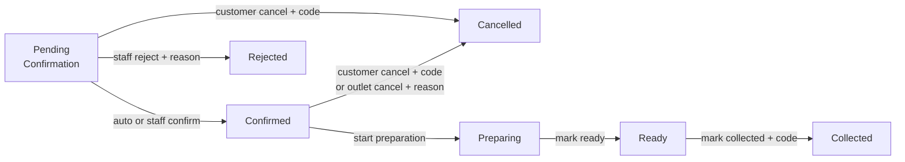

# System capabilities

Campus Food Pre-Order and Pickup lets students and staff order food from campus outlets ahead
of time and collect it in a chosen 30-minute pickup slot. Each outlet has a fixed quantity of
every item per slot, and the system makes sure that quantity is never oversold.

It runs locally as one Streamlit app over SQLite, with a role selector in place of login.

See also: [Architecture](architecture.md) · [Class diagram](class-diagram.md) ·
[Testing](testing.md)

## What each role can do

| Role | Capabilities |
| --- | --- |
| **Customer** | Pick an outlet, date and pickup slot and see live availability for every item (available count, Sold out, or Unavailable with reason). Build a pre-order from one outlet and submit it with campus ID and name. Receive an order number and a pickup code. Track orders by campus ID with a status timeline and any rejection or cancellation reason. Cancel a Pending or Confirmed order using the pickup code. Read in-app notifications. Get alternative slots offered when an order does not fit. |
| **Outlet Staff** | Work a queue grouped by slot and filtered by status, with *Needs review*, *Affected* and *Overdue* highlights. Confirm or reject (with reason) pending pre-orders. Move orders through Start preparation, Mark ready and Mark collected (pickup code required). Cancel a Confirmed order on the outlet's behalf with a reason. Find an order by number. Read outlet notifications. |
| **Outlet Manager** | Flag an item unavailable for one slot or a whole date with a reason, and see how many existing orders are affected (or make it available again). Turn auto-confirm on or off and set the bulk review threshold. View capacity, counted and available quantity per item per slot. Change a slot's capacity, never below what is already counted. |
| **Campus Admin** | Read-only view of every outlet's confirmation policy and of capacity versus demand per outlet, slot and item. |
| **System** | Auto-confirms ordinary pre-orders, records every status change with time, actor and reason, writes notifications, and keeps an app clock that drives slot cut-offs. |

## Core behaviours

- **Never oversells.** Availability is computed from orders on every read, and submit checks and
  reserves stock in one atomic database transaction, so two customers cannot both take the last unit.
- **All or nothing.** A pre-order is accepted whole or refused whole. Every failing line is
  listed, and nothing is reserved on refusal.
- **One outlet per order**, one pickup slot per order. Slots and outlets have independent stock.
- **Hybrid confirmation.** Ordinary orders (auto-confirm on, total within the threshold, default 10)
  are confirmed immediately. Bulk orders, or all orders when auto-confirm is off, wait for staff.
- **Forward-only lifecycle.** Pending Confirmation, Confirmed, Preparing, Ready, Collected. Rejected
  and Cancelled release stock; no step can be skipped or reversed. The UI offers only legal actions.
- **Protected cancel and collect.** A four-digit pickup code, shown once at submit, is needed to
  cancel or collect. Customers cannot cancel once preparation has started.
- **Humans stay in control of exceptions.** Flagging an item unavailable blocks new orders and
  blocks confirmation of pending ones, but existing orders are only marked *Affected*; staff
  decide to keep or cancel them.
- **Notifications and suggestions.** In-app inboxes with unread badge and toasts for customers
  and outlets. When an order does not fit, up to three later slots where the whole order fits are
  suggested; booking one re-runs full validation.
- **Demo-ready.** Seed data for two outlets (Main Canteen, Snack Kiosk), 7 items and 8 slots
  over 4 and 5 Aug 2026, an adjustable app clock (default 4 Aug 2026 10:00), and a
  **Reset demo data** button.

## Order lifecycle at a glance

## Not included

Login or passwords (anyone can switch role views), payments and pricing, editing a submitted
pre-order (place a new one instead), partial fulfilment or substitution, creating outlets or
slots from the UI, no-show handling, email or SMS, and live push updates (changes appear on
refresh).

## Status

All Must requirements, FR-M2, FR-M3, FR-M4, FR-A1 and FR-S5, plus the notifications and
next-available-slot bonuses, are built. 55 automated tests cover all 18 acceptance scenarios;
see [Testing](testing.md) for what is and is not covered.
