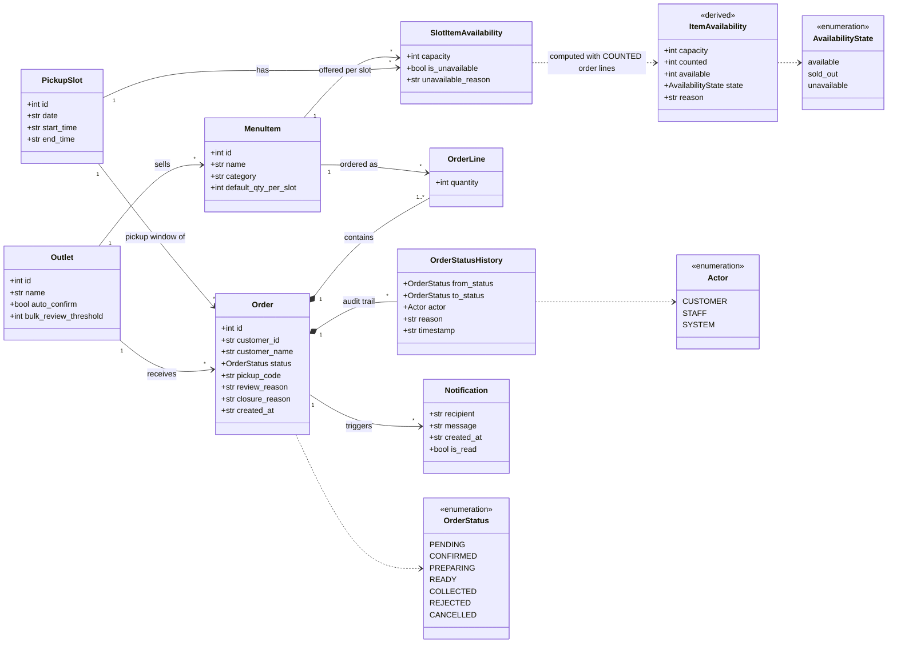
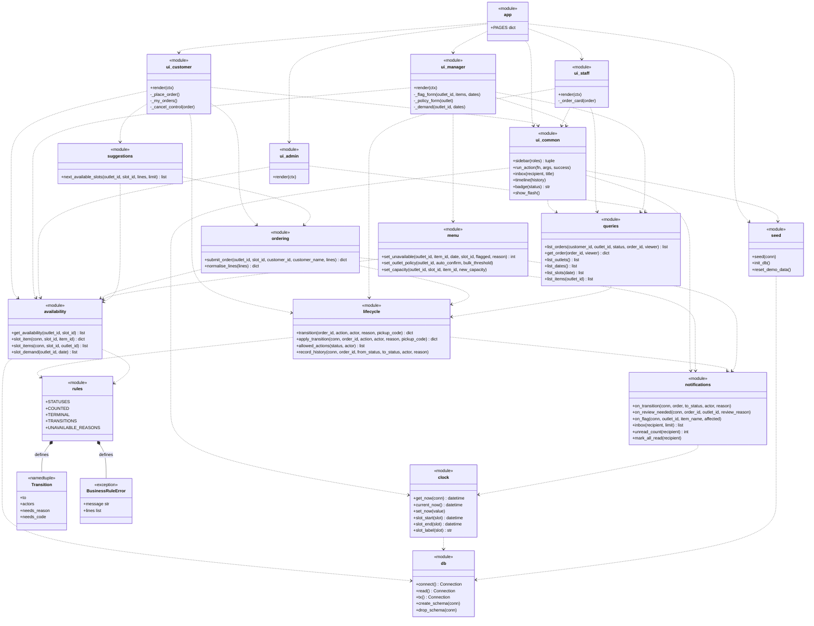

# Class diagrams (high level)

The implementation is function-oriented: the only real Python classes are `BusinessRuleError`
and the `Transition` named tuple. Domain data travels as SQLite rows and plain `dict`s, and
behaviour lives in modules. These diagrams therefore show two views:

1. **Domain model**: the entities and value types the system manipulates (backed by tables).
2. **Module model**: each module drawn as a class with its public operations, plus the two
   real classes. Modules are tagged `<<module>>`.

See also: [Architecture](architecture.md) · [System capabilities](capabilities.md) ·
[Testing](testing.md)

## 1. Domain model

Notes on the model:

- `ItemAvailability` is derived and never stored. It is computed on every read: `available = 0` if flagged, otherwise
  `max(capacity - counted, 0)`, where `counted` sums line quantities over orders in a COUNTED
  status. Its `state` is `unavailable` when flagged, `sold_out` when `available == 0`, else `available`.
- `OrderStatus` string values are `Pending Confirmation`, `Confirmed`, `Preparing`, `Ready`,
  `Collected`, `Rejected`, `Cancelled`. `Collected`, `Rejected` and `Cancelled` are terminal.
- `Notification.recipient` is a string key (`customer:<campus id>` or `outlet:<outlet id>`),
  not a foreign key, and `order_id` may be empty.
- A `Customer` is not an entity: orders carry `customer_id` (campus ID) and `customer_name` directly.

## 2. Module model

Dependency arrows (`..>`) read "uses". Every `services` module also uses `db` and `rules`;
those edges are omitted except where they define the module's purpose.

Every `services` module raises `BusinessRuleError` for a refused action; `ui_common.run_action`
catches it and shows `message` and each entry of `lines` in place.

### How the pieces map to the domain

| Domain concept | Owned by (writes) | Read through |
| --- | --- | --- |
| Order, OrderLine, OrderStatusHistory | `ordering` (create), `lifecycle` (status changes) | `queries.list_orders` |
| SlotItemAvailability (capacity, flags) | `menu` | `availability` |
| ItemAvailability (derived) | none, computed | `availability.slot_item(s)`, `get_availability`, `slot_demand` |
| Outlet policy (auto-confirm, threshold) | `menu.set_outlet_policy` | `queries.list_outlets` |
| Notification | `notifications` (inside the caller's transaction) | `notifications.inbox` |
| App clock (`app_setting`) | `clock.set_now`, `seed` | `clock.get_now`, `clock.current_now` |
| Outlet, MenuItem, PickupSlot | `seed` only (no UI to create them, A11) | `queries.list_*` |
