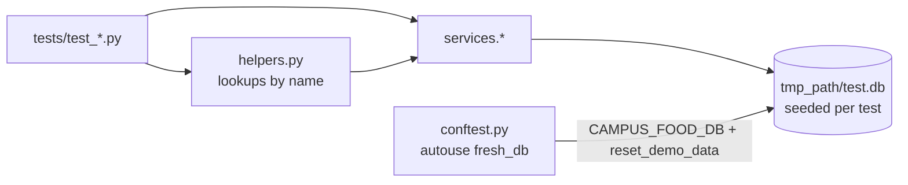

# Testing

The automated suite is 55 pytest tests in `src/tests/`. All 55 pass (last run 14 Oct 2026,
Python 3.13, pytest 9.1, about 4 seconds). Every acceptance scenario AT-01 to AT-18 from the
[requirements](requirements%20and%20design/campus-food-preorder-requirements-v2.md) has a test,
plus edge cases for validation, manager rules, notifications and slot suggestions.

See also: [Architecture](architecture.md) · [System capabilities](capabilities.md) ·
[Class diagram](class-diagram.md)

## 1. How to run

From the repository root:

```bash
pip install -r src/requirements.txt
pytest src/tests
```

## 2. Approach

- **Service layer, not UI.** Tests call `services.*` directly (`ordering`, `lifecycle`, `menu`,
  `availability`, `queries`, `notifications`, `suggestions`, `clock`). Business rules sit in
  modules with no Streamlit imports, which is what makes this possible (NFR-03).
- **Fresh database per test.** `conftest.py` has an autouse fixture that points
  `CAMPUS_FOOD_DB` at a new file under pytest's `tmp_path` and calls `reset_demo_data()`. Every
  test therefore starts from the same seed: two outlets, 7 items, 8 slots, three pre-committed
  Confirmed orders, app clock at 4 Aug 2026 10:00.
- **A file, not `:memory:`.** The concurrency test needs several connections to one database.
- **Tests read like the scenarios.** `helpers.py` looks up outlets, items and slots by name
  (`place`, `available`, `stock`, `act`, `flag`, `set_policy`, `status`, `history`), so a test
  such as AT-02 is a few lines of business language.
- **Assertions check state, not only exceptions.** Refusal tests assert the error message and
  that availability is unchanged; release tests assert stock returned.



## 3. Test files

| File | Tests | Covers |
| --- | ---: | --- |
| `test_availability.py` | 15 | Seed values, submit validation, all-or-nothing refusal, flags per date, slot and outlet isolation, sold-out, quantity and identity validation. |
| `test_lifecycle.py` | 12 | State machine: reject, cancel, preparing lock, double collect, flagged confirm, bulk review, outlet cancel, confirm without quantity re-check, actor and step restrictions. |
| `test_manager.py` | 10 | Capacity floor (BR-20), bulk-threshold policy, flag reason and scope, unflag, cross-outlet flag refusal. |
| `test_notifications.py` | 8 | In-app notification content and recipients, same-transaction behaviour, mark all read. |
| `test_suggestions.py` | 7 | Next-available-slot suggestions and booking one through full validation. |
| `test_scenarios.py` | 2 | End-to-end lifecycle (AT-01) and started-slot refusal (AT-13). |
| `test_concurrency.py` | 1 | Two simultaneous submits for the last unit (AT-12). |
| **Total** | **55** | |

`test_bad_quantities_refused` is parametrised over `0`, `-1` and `2.5`, so it counts as 3.

## 4. Acceptance scenarios

| ID | Scenario | Test | File |
| --- | --- | --- | --- |
| AT-01 | Full lifecycle: auto-confirm, prepare, ready, collect with code | `test_at01_full_lifecycle` | `test_scenarios.py` |
| AT-02 | Over-ask refused, stock unchanged | `test_at02_over_ask_refused_and_stock_unchanged` | `test_availability.py` |
| AT-03 | One failing line blocks the whole order | `test_at03_one_failing_line_blocks_the_whole_order` | `test_availability.py` |
| AT-04 | Unavailable flag applies per date | `test_at04_flag_is_per_date` | `test_availability.py` |
| AT-05 | Slots are isolated | `test_at05_slots_are_isolated` | `test_availability.py` |
| AT-06 | Last units, then Sold out | `test_at06_last_units_then_sold_out` | `test_availability.py` |
| AT-07 | Reject releases stock and is terminal | `test_at07_reject_releases_stock_and_is_terminal` | `test_lifecycle.py` |
| AT-08 | Cancel needs the right pickup code | `test_at08_cancel_needs_the_right_pickup_code` | `test_lifecycle.py` |
| AT-09 | No customer cancel once Preparing | `test_at09_no_customer_cancel_once_preparing` | `test_lifecycle.py` |
| AT-10 | Cannot collect twice | `test_at10_cannot_collect_twice` | `test_lifecycle.py` |
| AT-11 | Flagged item blocks confirm, allows reject | `test_at11_flagged_item_blocks_confirm_but_allows_reject` | `test_lifecycle.py` |
| AT-12 | Exactly one concurrent submit wins the last unit | `test_at12_exactly_one_submit_wins_the_last_unit` | `test_concurrency.py` |
| AT-13 | Started slot refused on the app clock | `test_at13_started_slot_is_refused` | `test_scenarios.py` |
| AT-14 | Bulk order goes to staff review | `test_at14_bulk_order_goes_to_staff_review` | `test_lifecycle.py` |
| AT-15 | Outlet cancel after a flag, with reason | `test_at15_outlet_cancel_after_flag` | `test_lifecycle.py` |
| AT-16 | Mixed-outlet cart refused | `test_at16_mixed_outlet_cart_refused` | `test_availability.py` |
| AT-17 | Confirm does not re-check quantity | `test_at17_confirm_does_not_recheck_quantity` | `test_lifecycle.py` |
| AT-18 | Outlets are isolated | `test_at18_outlets_are_isolated` | `test_availability.py` |

## 5. Additional tests beyond the acceptance scenarios

| Test | Verifies |
| --- | --- |
| `test_seed_matches_section_9` | Seed availability matches the spec table, including the Cold Coffee flag on 4 Aug only. |
| `test_all_failing_lines_are_listed_together` | V-07: every failing line is reported, not only the first. |
| `test_bad_quantities_refused[0, -1, 2.5]` | V-02: whole-number quantities of 1 or more. |
| `test_duplicate_lines_are_merged` | Repeated item lines are summed into one line. |
| `test_blank_identity_refused` | V-01: campus ID and name required. |
| `test_pickup_code_is_four_digits` | BR-06: code is four digits. |
| `test_auto_confirm_is_visible_in_the_timeline` | FR-X2: Customer then System entries in the history. |
| `test_cannot_skip_a_step` | BR-15, V-12: Confirmed cannot jump to Ready. |
| `test_customer_cannot_cancel_a_rejected_order` | BR-11, V-12: Rejected is closed to the customer. |
| `test_customer_cannot_use_staff_actions` | Actor restriction from the transition table. |
| `test_capacity_cannot_go_below_counted` | BR-20, V-13: exact refusal message, stock unchanged. |
| `test_capacity_at_counted_is_allowed_and_sells_out` | Boundary: capacity equal to counted gives available 0. |
| `test_capacity_increase_adds_stock` | A raised capacity is bookable immediately. |
| `test_capacity_rejects_non_whole_numbers` | Negative capacity refused. |
| `test_policy_threshold_must_be_positive` | FR-M2: threshold below 1 refused. |
| `test_policy_threshold_moves_the_bulk_line` | Threshold 3: 3 units auto-confirm, 4 go to review. |
| `test_flag_requires_a_known_reason` | BR-17: blank or unknown reason refused. |
| `test_flag_for_one_slot_leaves_others_open` | Slot-scoped flag does not touch other slots. |
| `test_unflag_restores_availability` | Un-flagging returns the full capacity. |
| `test_cannot_flag_another_outlets_item` | Manager scope is one outlet. |
| `test_ready_notifies_customer_with_slot` | Customer message on Ready includes the slot. |
| `test_reject_notifies_customer_with_reason` | Customer message on Reject includes the reason. |
| `test_outlet_cancel_notifies_customer_with_outlet_and_reason` | Message names the outlet and the reason. |
| `test_customer_cancel_notifies_outlet_not_customer` | Own cancel alerts the outlet only. |
| `test_bulk_order_alerts_the_outlet` | Review-needed alert to the outlet. |
| `test_flag_alerts_the_outlet_with_affected_count` | Flag alert carries the affected-order count. |
| `test_mark_all_read` | Unread count drops to zero. |
| `test_failed_action_leaves_no_notification` | A refused action writes no notification. |
| `test_oversized_order_gets_later_slots_where_it_fits` | Suggestions are later slots, across dates, where the whole order fits. |
| `test_only_later_slots_are_suggested` | No earlier or equal slot is suggested. |
| `test_no_suggestion_when_the_slot_would_accept_the_order` | Empty list when the refusal was not about the slot. |
| `test_flagged_item_skips_to_the_next_date` | Flagged items are skipped to the next date. |
| `test_started_slot_suggests_later_slots` | A started slot yields later suggestions. |
| `test_mixed_outlet_cart_gets_no_suggestions` | Invalid carts get no advice. |
| `test_suggested_slot_can_be_booked_through_full_validation` | Booking a suggestion goes through `submit_order`. |

## 6. Business rule coverage

| Rule | Tests |
| --- | --- |
| BR-01 one customer, one outlet, one slot, lines of quantity 1 or more | `test_blank_identity_refused`, `test_bad_quantities_refused`, `test_duplicate_lines_are_merged` |
| BR-02 one outlet per order | AT-16 |
| BR-03 derived availability | `test_seed_matches_section_9`, AT-05, AT-18 |
| BR-04 all-or-nothing submit | AT-02, AT-03, `test_all_failing_lines_are_listed_together` |
| BR-05 atomic check-and-reserve | AT-12 |
| BR-06 pickup code issued at submit | `test_pickup_code_is_four_digits`, AT-01 |
| BR-07, BR-08, BR-09 hybrid confirmation | AT-01, AT-07, AT-14, `test_policy_threshold_moves_the_bulk_line`, `test_auto_confirm_is_visible_in_the_timeline` |
| BR-10 confirm checks flags, not quantity | AT-11, AT-17 |
| BR-11 reject is terminal and releases stock | AT-07, `test_customer_cannot_cancel_a_rejected_order` |
| BR-12 customer cancel with code | AT-08 |
| BR-13 outlet cancel with reason | AT-15 |
| BR-14 no customer cancel from Preparing | AT-09 |
| BR-15 forward-only steps | AT-01, `test_cannot_skip_a_step` |
| BR-16 collect needs Ready and the code | AT-01, AT-10 |
| BR-17 availability flags with reason | AT-04, `test_flag_requires_a_known_reason`, `test_flag_for_one_slot_leaves_others_open`, `test_unflag_restores_availability`, `test_cannot_flag_another_outlets_item` |
| BR-18 flag blocks confirm, marks orders Affected | AT-11, AT-15 |
| BR-19 sold out is derived | AT-06 |
| BR-20 capacity floor | `test_capacity_*` in `test_manager.py` |
| BR-21 slot cut-off on the app clock | AT-13 |
| BR-22 no partial fulfilment or substitution | AT-03, AT-16 |

## 7. Not covered by automated tests

These are real gaps, listed so nobody assumes they are verified.

| Gap | Why it matters |
| --- | --- |
| **No UI tests.** Nothing exercises `src/ui/*`: forms, role routing, disabled Cancel button, toasts, unread badge, `run_action` error display. | Page behaviour (NFR-05, FR-C5 button state, FR-S1 highlighting) is verified only by hand. |
| **Confirm after the slot has ended** (`lifecycle._check_confirmable`, V-08 timing half). Only the flag half is tested. | BR-10 has two conditions; one is untested. |
| **`overdue` and `needs_review` flags** from `queries.list_orders` (FR-S1, A14). `affected` is tested via AT-15. | The staff queue highlights rely on these. |
| **`allowed_actions` per status and actor.** Only `outlet_cancel` on a Confirmed order is asserted directly. | It drives which buttons the UI shows. |
| **App clock default and persistence** (FR-X3). `set_now` is used by AT-13 and a suggestion test, and every test relies on the 4 Aug 10:00 default implicitly, but neither the default value nor persistence is asserted. | Clock drives cut-offs and every timestamp. |
| **Notification messages for Confirmed, Preparing and Collected.** Ready, Rejected, Cancelled, review and flag alerts are covered. | Three customer messages have no assertion. |
| **Concurrency beyond one scenario.** Only two simultaneous submits for the last unit. Confirm, cancel and capacity-change races are untested. | `tx()` protects them by design but nothing proves it. |
| **Restart persistence and `init_db` idempotency** (NFR-02). The fixture always starts from a reset database. | "Data survives a restart" is not asserted. |
